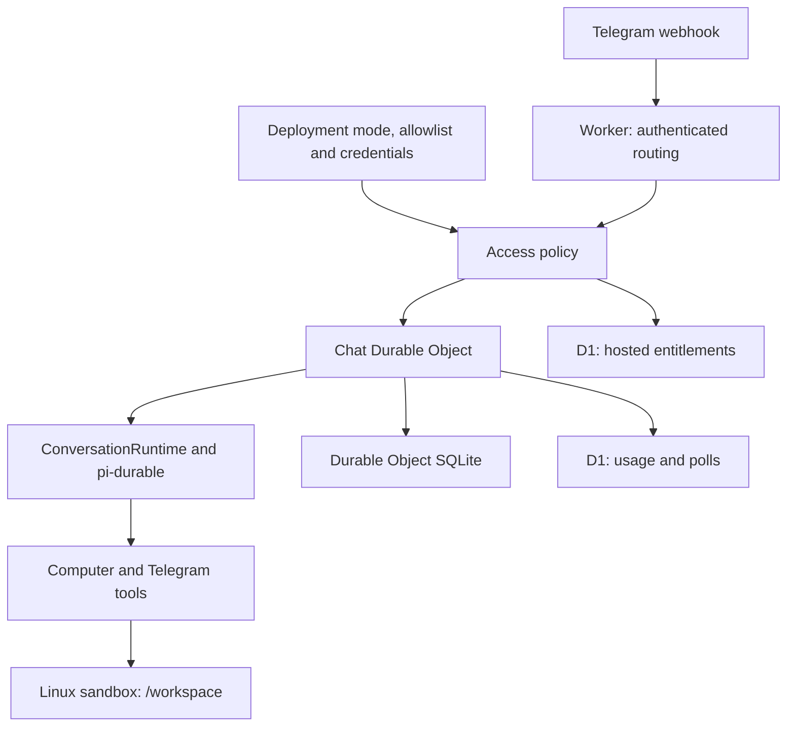

# One application for every deployment

Managed service, self-hosting, and local development execute `cloud/src/index.ts`, the same `Chat` Durable Object, and the same Linux sandbox Dockerfile. There is one package and lockfile at the repository root.

`cloud/src/access.ts` implements the deployment's access policy. Hosted mode uses free-chat receipts, trials, and verified subscription entitlements. Self-hosted mode uses the operator's allowlist and ignores commercial grants, free receipts, and stored beta settings. The deployment mode comes from Worker configuration. It cannot be changed through chat, model tools, or commercial settings endpoints. Credential handling, usage accounting, and the agent runtime are the same in both modes.

`cloud/src/chat.ts` owns authenticated input admission, model configuration, Telegram tools and poll context, provider caching, usage accounting, and wakeup scheduling. It persists the existing `glav.chat` document and root conversation. Legacy model selections stored as strings are normalized on read; new selections include their provider.

`cloud/src/runtime/conversation.ts` owns steering, pending-answer recovery, answer deduplication, command handling, drafts, and send ordering. The pi-durable harness owns the model/tool loop and durable task history. Chat supplies its durable state, Telegram destination, and alarm callbacks.

`cloud/src/runtime/computer.ts` defines `bash`, `read_file`, and `write_file`: their schemas, replay rules, deadlines, output limits, and exit-code handling. `cloud/src/computer.ts` performs those operations in the chat's Linux sandbox and manages acquisition, process cancellation, idle timeout, snapshots, and computer time. Commands run at `/workspace` in that sandbox. Model and Telegram credentials stay in the Worker.

`cloud/src/runtime/skills.ts` discovers `SKILL.md` frontmatter under the sandbox's `/workspace/.agents/skills` directory. The computer extension renders the catalog as a Pi Durable prompt section before each model turn. The model reads matching skill instructions through `read_file`; full skill bodies are not added to the catalog. Chats without computer access do not scan or receive skills. See [skills](skills.md) for installation and discovery rules.

`cloud/src/runtime/content.ts` turns Telegram attachments into model input, using the chat's download, transcription, and sandbox-save operations. Permanent download failures become input notes; transient failures remain retryable. An already admitted update skips attachment processing.

Snapshot renewal uses the same renewal controller and alarm scheduler in every deployment. A renewal-only alarm runs without opening an agent conversation or sending Telegram messages. Local development uses Wrangler's Worker, Durable Object, D1, and container machinery; self-hosting uses those resources in the operator's Cloudflare account.

Delivery state is committed after Telegram accepts a reply. Failed sends leave a pending submission, and watchdog alarms recover it without another model generation. Telegram does not provide a transactional receipt for ordinary final replies, so a crash between acceptance and the durable commit can still duplicate a send.

Tests cover both access policies against the same Worker entrypoint, self-hosted restart deduplication, hosted trials and subscriptions, tool enforcement, attachments, drafts, delivery recovery, command cancellation, and snapshot maintenance. Wrangler dry runs validate both deployment configurations. Live deployment and payment collection are separate acceptance steps.
